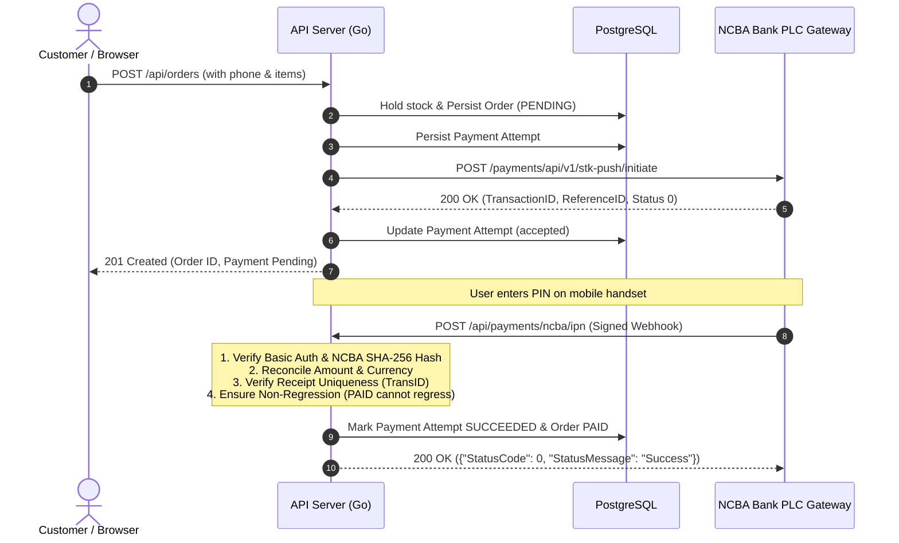

# R14 Evidence: Bounded Provider Adapter and Guarded Callbacks

**Issue:** [#20 - [R14] Implement bounded provider adapter and guarded callbacks](https://github.com/dev-bramwel/Bliss-Atelier-Perfumes/issues/20)  
**Milestone:** Week 3: Safe payments and background work  
**Status:** Completed and verified locally against unit tests and disposable PostgreSQL integration tests  

---

## 1. Problem and Outcome

Mobile money and bank payment gateways (specifically NCBA Bank Kenya Till STK push, C2B Query, and Paybill IPN push notification webhooks) operate across asynchronous, potentially unreliable mobile networks. Without bounded client transports, strict signature verification, and guarded state transitions, systems are vulnerable to hanging connections, forged callbacks, replay attacks, duplicate payment credits, and race conditions where late failure notifications overwrite settled successful payments.

R14 delivers:
1. **Typed Provider Port & Bounded Transport (`internal/provider`)**:
   - `PaymentProvider` interface with `InitiateSTK`, `QuerySTK`, and `QueryReceipt`.
   - Concrete `NCBAAdapter` utilizing bounded HTTP client transport (`DoJSON`) with per-request timeouts (30s) and strict payload validation.
   - Race-safe token caching (`sync.RWMutex`) with a 5-minute pre-expiry buffer to avoid redundant OAuth/token fetches.
   - Testable `FakeAdapter` supporting deterministic failure/timeout modes: `ModeAccept`, `ModeReject`, `ModeTimeout`, and `ModeMalformed`.
2. **NCBA Bank PLC Specification Compliance**:
   - Till STK Push endpoint: `POST /payments/api/v1/stk-push/initiate` via PayBillNo `880100` and Merchant AccountNo (Till alias).
   - Kenyan MSISDN formatting utility ensuring strict `2547XXXXXXXX` / `2541XXXXXXXX` format.
   - Official NCBA IPN SHA-256 signature algorithm verification:
     `Hash = Base64( LowercaseHex( SHA256( secretKey + TransType + TransID + TransTime + TransAmount + BusinessShortCode + BillRefNumber + Mobile + Name + "1" ) ) )`.
   - C2B Query API client (`POST /payments/api/v1/c2b/query`).
3. **Guarded Callback Endpoints (`POST /api/payments/ncba/ipn`, `POST /api/mpesa/callback`)**:
   - HTTP Basic Auth / credential verification against configured IPN credentials.
   - Callback URL capability verification via HMAC-SHA256 token matching the order ID. The URL capability is explicitly scoped to route invocation and **never treated as a provider body signature**.
   - Body amount and currency reconciliation ensuring received funds match or exceed the order total.
   - Duplicate receipt protection: checks `payment_attempt` and orders to prevent credit duplication for already processed `TransID`s.
   - **Settled success never regresses**: Orders already marked `PAID` cannot be downgraded or altered by duplicate success or late failure notifications.
   - Graceful handling of callback-before-mapping and UNKNOWN initiation states (ambiguous timeouts remain preserved without premature order cancellation or double billing).

---

## 2. Architecture & Invariants

### Safety Invariants Enforced:
- **Zero Raw Secrets in Code**: All NCBA and callback secrets are injected via environment variables (`GO_NCBA_*`, `GO_MPESA_CALLBACK_SECRET`).
- **Settled Success Non-Regression**: Once an order reaches `PAID`, any subsequent duplicate callback or late error callback acknowledges HTTP 200 OK to the bank without mutating the order state.
- **Durable Unresolved Attempt Guard**: Retries are rejected if an unresolved attempt is currently in-flight.
- **Provider Body Signature Independence**: URL tokens verify route access, while payload signatures (`Hash`) authenticate bank payloads independently.

---

## 3. Verification & Test Evidence

### A. Unit Tests
Executed across all packages (`go test -count=1 ./...`):
- `TestNCBA_InitiateSTK_Success`: Verified request serialization, Bearer token injection, and response parsing.
- `TestNCBA_InitiateSTK_TokenCaching`: Verified that token caching reuses the active token across calls and refreshes when expired.
- `TestNCBA_InitiateSTK_Errors`: Verified rejection handling on HTTP 400 (`ErrProviderRejected`) and timeout handling (`ErrProviderTimeout`).
- `TestNCBA_IPNVerification`: Verified official NCBA SHA-256 Base64 hash verification against valid and tampered payloads.
- `TestNCBA_QueryReceipt`: Verified C2B query request and response mapping.
- `TestFormatKenyanPhone`: Verified phone normalizer for `07...`, `+2547...`, and `2547...`.
- `TestNCBA_IPN_Success`: Verified full HTTP callback lifecycle updating attempt to `succeeded` and order to `PAID`.
- `TestNCBA_IPN_TamperedHash`: Verified that bad hashes return HTTP 401 Unauthorized.
- `TestNCBA_IPN_SettledOrderNeverRegresses`: Verified that once an order is `PAID`, subsequent duplicate or failure callbacks do not mutate the order.
- `TestNCBA_IPN_DuplicateReceipt`: Verified that duplicate receipt numbers on different orders are rejected with HTTP 409 Conflict.
- `TestNCBA_IPN_AmountMismatch`: Verified that underpaid transactions are rejected with HTTP 422 Unprocessable Entity.

### B. Integration Tests
Executed `scripts/test-integration.ps1`:
- Disposable PostgreSQL database container spun up.
- All migrations 1 through 6 applied successfully.
- Database backup/restore and table migration fingerprints verified.
