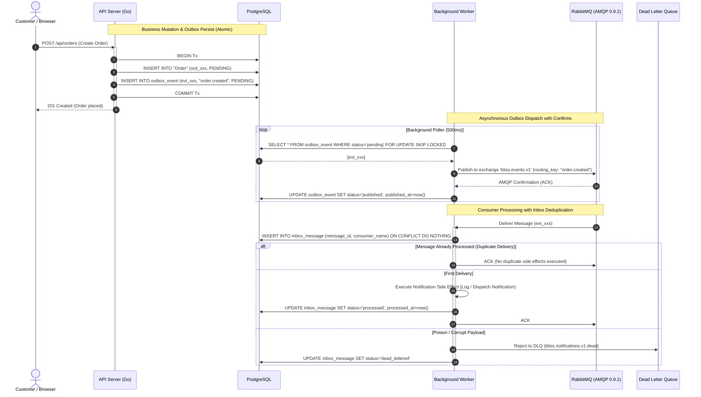

# R15 Evidence: Transactional Outbox and RabbitMQ Background Workers

**Issue:** [#21 - [R15] Deliver transactional outbox and RabbitMQ workers](https://github.com/dev-bramwel/Bliss-Atelier-Perfumes/issues/21)  
**Milestone:** Week 3: Safe payments and background work  
**Status:** Completed and verified locally against unit tests and disposable PostgreSQL integration tests  

---

## 1. Problem and Outcome

Directly publishing asynchronous broker events inside business request transactions introduces the classic "dual-write" failure mode:
1. If the database transaction commits but the network or broker fails during publish, the event is permanently lost, leading to inconsistent downstream state (e.g. notifications never sent, audit records missing).
2. If the broker publish succeeds but the database transaction aborts or rolls back, a phantom event is emitted to external consumers for state changes that never happened.
3. If publishing blocks synchronously on broker responsiveness, broker network latency or outages directly degrade or take down customer checkout and payment confirmation.
4. Downstream consumer networks can redeliver AMQP deliveries at any time; without durable deduplication, side-effects (such as email/SMS notifications) are repeatedly duplicated.
5. Corrupt or unparseable messages can cause perpetual retry loops that starve consumer queues ("poison message").

### R15 Outcomes Delivered:
1. **Atomic Transactional Outbox (`public.outbox_event`)**:
   - Outbox records are inserted into PostgreSQL within the **exact same `pgx.Tx`** as order creations, payment confirmations, and payment attempts.
   - Zero dual-write hazard: business mutations and outbox entries either commit together or roll back together atomically.
2. **Standardized AMQP 0.9.1 Topology (`internal/messaging`)**:
   - Topic Exchange: `bliss.events.v1` (durable).
   - Event Queues: `bliss.notifications.v1` (bound to `order.*`, `payment.*`, `delivery.*`).
   - Dead Letter Queue: `bliss.notifications.v1.dead` (durable, captures unparseable/poison payloads).
   - Delayed Retry Queue: `bliss.notifications.v1.retry` (with DLX routing back to main exchange after 5,000ms TTL).
3. **Publisher Confirms & Dispatcher (`internal/outbox`)**:
   - Background dispatcher polls pending outbox events (`SELECT ... FOR UPDATE SKIP LOCKED`).
   - Confirms are verified from RabbitMQ broker; events are only marked `published` upon explicit ACK.
   - On broker NACK or publish failure, retry counters increment up to `max_retries` before being marked `failed`.
4. **Durable Consumer Deduplication (`public.inbox_message`)**:
   - Background worker processes messages with unique deduplication keys (`message_id` + `consumer_name`).
   - Redelivered messages that were already marked `processed` immediately acknowledge (ACK) to the broker without re-executing business side effects.
5. **Poison Message Quarantine to DLQ (`internal/worker`)**:
   - Malformed JSON envelopes, unrecognized schemas, or missing message IDs are rejected immediately (`Reject(false)` / `x-dead-letter-exchange`) into `bliss.notifications.v1.dead` without blocking valid queue traffic.
6. **Broker Outage Independence**:
   - Customer order creation and payment confirmation never depend on RabbitMQ being online. If RabbitMQ is unavailable, outbox events safely accumulate in `pending` status in PostgreSQL.
   - The worker supervisor automatically retries connection with backoff, resuming publishing and draining pending outbox batches once the broker recovers.

---

## 2. Architecture & Invariants



### Safety Invariants Enforced:
- **Broker Independence**: Database mutations commit completely independent of broker state. If RabbitMQ is down, transactions succeed normally and accumulate in `outbox_event`.
- **Publisher Confirms**: An outbox event is NEVER updated to `published` status without an explicit AMQP confirmation from the broker.
- **Exactly-Once Side Effect Delivery**: Redelivered messages are caught by `inbox_message` constraint (`(message_id, consumer_name)` primary key) ensuring notification handlers execute at most once.
- **Poison Containment**: Corrupted payloads or missing message IDs do not crash the worker or requeue forever; they are isolated to `bliss.notifications.v1.dead` for operator review.
- **Graceful Shutdown**: The background publisher and consumer hook into OS signal context cancellation, flushing in-flight confirms and closing channels cleanly before exit.

---

## 3. Database Schema Migration (Step 7)

Migration file: `internal/migration/sql/0007_transactional_outbox_inbox.sql`

```sql
CREATE TABLE IF NOT EXISTS public.outbox_event (
    id TEXT PRIMARY KEY,
    event_type TEXT NOT NULL,
    aggregate_id TEXT NOT NULL,
    aggregate_version INTEGER NOT NULL DEFAULT 1,
    correlation_id TEXT,
    schema_version INTEGER NOT NULL DEFAULT 1,
    payload JSONB NOT NULL,
    destination TEXT NOT NULL DEFAULT 'rabbitmq',
    status TEXT NOT NULL DEFAULT 'pending',
    retry_count INTEGER NOT NULL DEFAULT 0,
    last_error TEXT,
    created_at TIMESTAMPTZ NOT NULL DEFAULT now(),
    updated_at TIMESTAMPTZ NOT NULL DEFAULT now(),
    published_at TIMESTAMPTZ
);

CREATE INDEX IF NOT EXISTS idx_outbox_event_pending
    ON public.outbox_event (created_at)
    WHERE status = 'pending';

CREATE TABLE IF NOT EXISTS public.inbox_message (
    message_id TEXT NOT NULL,
    consumer_name TEXT NOT NULL,
    event_type TEXT NOT NULL,
    payload JSONB NOT NULL,
    status TEXT NOT NULL DEFAULT 'received',
    received_at TIMESTAMPTZ NOT NULL DEFAULT now(),
    processed_at TIMESTAMPTZ,
    last_error TEXT,
    PRIMARY KEY (message_id, consumer_name)
);
```

---

## 4. Verification & Test Evidence

### A. Unit Tests (`go test -count=1 ./...`)
- **`internal/events`**:
  - `TestNewEvent_Validation`: Validated required envelope attributes (`event_id`, `event_type`, `aggregate_id`, `schema_version`).
  - `TestPayloadSerialization`: Verified JSON serialization and deserialization for `order.created`, `order.paid`, and `payment.attempt`.
- **`internal/messaging`**:
  - `TestFakeMessaging_PublishAndConsume`: Verified exchange routing and consumer dispatch in memory.
  - `TestFakeMessaging_DeduplicationAndAck`: Verified ACK/NACK mechanics.
  - `TestFakeMessaging_DLQ`: Verified poison message routing to Dead Letter Queue.
  - `TestFakeMessaging_BrokerOutage`: Simulated broker connection failure and recovery.
- **`internal/outbox`**:
  - `TestPublisherConfig_Defaults`: Verified standard default settings (500ms poll interval, 50 batch size, 5 max retries).
  - `TestToRoutingKey`: Verified conversion from event types to AMQP routing keys (e.g. `order.created.v1` -> `order.created`).
  - `TestBackgroundPublisher_LifecycleAndConfirms`: Verified batch fetching, confirm verification, and state transition to `published`.
  - `TestBackgroundPublisher_BrokerOutage`: Verified outbox publisher handles broker downtime without crashing and resumes once restored.
- **`internal/worker`**:
  - `TestNotificationConsumer_Deduplication`: Verified that redelivered deliveries trigger ACK without executing duplicate handler calls.
  - `TestNotificationConsumer_PoisonPayloadRoutesToDLQ`: Verified unparseable envelopes route directly to DLQ.
  - `TestNotificationConsumer_MissingMessageIDRoutesToDLQ`: Verified payloads missing message IDs route to DLQ.
  - `TestNotificationConsumer_HandlerErrorNacks`: Verified transient handler errors trigger Nack for redelivery.
- **`internal/orders`**:
  - Verified `CreateOrder`, `ConfirmPayment`, and `CreatePaymentAttempt` atomically insert outbox events in the same `pgx.Tx`.
- **`internal/process`**:
  - `TestWorkerCancellation`: Verified graceful startup and cancellation of the background worker process.

### B. Integration Tests (`scripts/test-integration.ps1`)
- Spun up disposable PostgreSQL container.
- Applied migrations 1 through 7 sequentially.
- Inspected table schema against verified `schema-v7.json`.
- Tested database seed, backup via `pg_dump`, drop cascade across 20 tables (including `outbox_event` and `inbox_message`), and restore via `pg_restore`.
- Verified pre-backup and post-restore data/history fingerprints match perfectly.
- Result: **R06 backup/restore/re-adoption drill passed; full data/history fingerprint preserved.**
