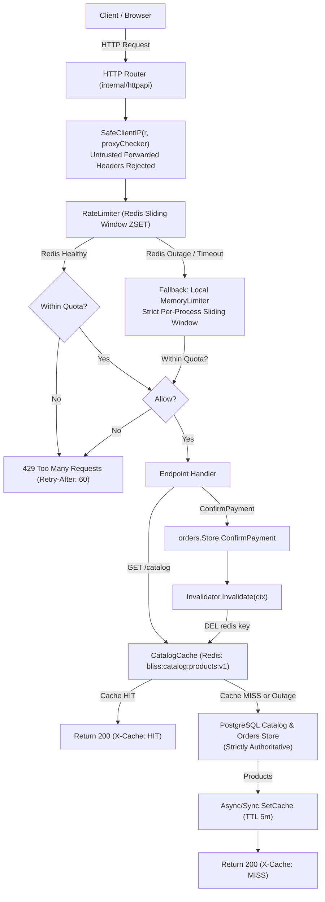

# R16 Evidence: Redis Cache and Security-Aware Rate Limits

**Issue:** [#22 - [R16] Add Redis cache and security-aware rate limits](https://github.com/dev-bramwel/Bliss-Atelier-Perfumes/issues/22)  
**Milestone:** Week 3: Safe payments and background work  
**Status:** Completed and verified locally against unit tests, disposable Redis/PostgreSQL integration tests, and Docker Core verification  

---

## 1. Problem and Outcome

Directly exposing PostgreSQL to high-frequency catalog read requests, bot probing, and checkout submissions introduces several critical operational and security risks:
1. **Database Degradation under High Traffic**: Repeated public queries for the catalog (`GET /catalog`, `GET /api/catalog`) trigger dynamic joins and reservation hold checks across `catalog_product`, `catalog_settings`, `stock_control`, and `stock_reservation`. Without caching, traffic spikes cause excessive CPU and database pool contention.
2. **Stale Inventory Hazards**: If a cache does not immediately invalidate upon stock and price changes (payment confirmations, batch stock adjustments, or expired reservation releases), customers will view phantom availability or incorrect pricing.
3. **Cache Outage Fragility**: If the storefront hard-depends on Redis availability, a Redis crash, network timeout, or cache restart takes down the entire store and checkout experience.
4. **Rate Limit Bypass via Spoofed Headers**: Attackers routinely inject arbitrary `X-Forwarded-For` or `Client-IP` headers to rotate apparent IP addresses, evading per-IP brute force or denial-of-service protections.
5. **Rate Limit Bypass via Cache Failure (Fail-Open Vulnerability)**: Distributed rate limiters that fail open when the cache is down allow attackers to intentionally DDoS the cache to bypass rate limits on sensitive endpoints (payment prompts, order submission, login).

### R16 Outcomes Delivered:
1. **Public Catalog Read-Through Cache (`internal/rediscache`)**:
   - Public catalog queries (`GET /catalog` and `GET /api/catalog`) are served from Redis (`bliss:catalog:products:v1`) with a bounded 5-minute TTL.
   - Cache hit/miss observability: Responses set `X-Cache: HIT` on cache hits and `X-Cache: MISS` on cache misses or bypasses.
2. **Explicit Stock and Price Invalidation**:
   - Stock and price updates immediately purge the Redis cache key:
     - Payment Confirmation (`orders.Store.ConfirmPayment`): stock deduction and reservation commitment trigger `Invalidate(ctx)`.
     - Reservation Expiry Sweeps (`orders.Store.ReleaseExpired`): background releases of expired checkout holds trigger `Invalidate(ctx)`.
     - Stock Ledger Batches (`catalog.Store.Apply`): openings, receipts, adjustments, and reconciliations trigger `Invalidate(ctx)`.
     - Operator Manual Invalidation: protected endpoint `POST /api/catalog/invalidate` allows authenticated operators (`X-Manager-Secret`) to immediately purge cache.
3. **Bounded Read Fallback on Cache Outage**:
   - PostgreSQL remains strictly authoritative for all product, stock, price, and order records.
   - If Redis times out (150ms bounded operation context) or is completely unreachable, reads seamlessly fall back to PostgreSQL with zero customer-visible errors (`X-Cache: MISS`).
4. **Security-Aware Rate Limiting with In-Memory Outage Fallback**:
   - Atomic sliding window counter implemented via Redis Sorted Sets (`ZSET`) and Lua script (`internal/rediscache/limiter.go`).
   - Protected endpoints:
     - Order Creation (`POST /api/orders`): 10 requests / minute per client IP.
     - Payment Retry / Prompts (`POST /api/orders/{id}/retry-payment`): 5 requests / minute per client IP.
     - Order Lookup (`GET /api/orders/{id}`, `GET /api/orders/{id}/payment-status`, `GET /api/orders/{id}/attempts`): 30 requests / minute per client IP.
     - Manager Actions (`POST /api/catalog/invalidate`): 20 requests / minute per manager IP.
   - **Zero Header Spoofing Bypass**: Client IP extraction strictly uses `SafeClientIP(r, proxyChecker)` which ignores forged `X-Forwarded-For` headers from untrusted proxy hops.
   - **Zero Outage Bypass**: If Redis is unreachable or times out, rate limiters automatically fall back to an internal in-memory sliding-window limiter (`MemoryLimiter`). Limits continue to be strictly enforced per process—abuse limits cannot be bypassed by attacking Redis.
5. **Private Docker Topology**:
   - Added `redis` service to `compose.yaml` using `redis:7-alpine`, memory capped at `128m`, run as non-root UID `999:999`, with `read_only: true` root filesystem and isolated inside the `private` internal Docker network (no exposed host ports).

---

## 2. Architecture & Invariants



---

## 3. Delivery Summary & Code Changes

| Package / File | Scope of Changes |
| :--- | :--- |
| `internal/config/config.go` | Added `RedisURL` field; loaded via `GO_REDIS_URL` or `GO_REDIS_URL_FILE` with mutual exclusivity and URL scheme validation. |
| `internal/config/config_test.go` | Added comprehensive tests for env, file, conflict, and invalid URL formats for Redis. |
| `internal/rediscache/client.go` | Connection management wrapping `*redis.Client` with bounded timeouts (`DialTimeout: 2s`, `ReadTimeout: 200ms`, `WriteTimeout: 200ms`, `PoolSize: 10`). |
| `internal/rediscache/catalog.go` | Read-through catalog cache with bounded TTL (5m), bounded operation timeout (150ms), and `CatalogInvalidator` interface. |
| `internal/rediscache/limiter.go` | Sliding window limiter with atomic Redis Lua script (`ZREMRANGEBYSCORE`, `ZCARD`, `ZADD`, `PEXPIRE`) and local in-memory fallback (`MemoryLimiter`). |
| `internal/rediscache/*_test.go` | Unit tests for cache hits/misses, Redis outage fallback, rate limiter sliding window, and outage limit enforcement. |
| `internal/catalog/catalog.go` | Attached optional `Invalidator` to `Store`; calls `Invalidate(ctx)` after `Apply` and `Approve` commits. |
| `internal/orders/store.go` | Attached optional `CatalogInvalidator` to `Store`; calls `Invalidate(ctx)` after `ConfirmPayment`, `ReleaseExpired`, `CreateOrder`, and `CancelOrder` commits. |
| `internal/httpapi/server.go` | Registered `X-Cache` headers on `GET /catalog` and `GET /api/catalog`; wired rate limiters to order creation, payment retry, order lookups, and manager endpoints; added `POST /api/catalog/invalidate`. |
| `internal/httpapi/redis_test.go` | HTTP integration tests for catalog caching, outage fallback, manager cache invalidation, and rate limiting with spoofed header rejection. |
| `internal/process/process.go` | Initializes Redis client from `GO_REDIS_URL`, wires `CatalogCache` to stores, and passes to API and worker sweeps. |
| `compose.yaml` | Added `redis` service (`redis:7-alpine`, `user: 999:999`, `read_only: true`, `mem_limit: 128m`, internal network `private`); passed `GO_REDIS_URL` to `api`. |
| `scripts/Test-DockerCore.ps1` | Added `'redis'` service to non-root, read-only rootfs, and host-port isolation verification suite. |
| `scripts/test-integration.ps1` | Launches disposable Redis container for integration test suite execution and cleans up in `finally`. |

---

## 4. Security & Abuse Controls

### 4.1 Header Spoofing Defense
- Rate limiting keys are derived exclusively from `SafeClientIP(r, proxyChecker)`:
  - If the client's immediate `RemoteAddr` is not in configured `TrustedProxies` (e.g. `10.0.0.0/8`, `127.0.0.1/32`), any supplied `X-Forwarded-For` header is **strictly discarded**.
  - If `RemoteAddr` is a trusted proxy hop, `X-Forwarded-For` is parsed right-to-left to locate the first untrusted upstream IP.
  - Attackers cannot rotate pseudo-random `X-Forwarded-For` headers to reset rate limits.

### 4.2 Outage Security Policy: Never Fail Open
- Traditional rate limiters fail open during cache outages, allowing adversaries to flood endpoints during Redis restarts or network partitions.
- Bliss Atelier's `RateLimiter` enforces a strict **in-memory sliding window fallback**:
  - If Redis is unreachable, errors, or times out, the limiter falls back to `fallback.Allow(key, time.Now())`.
  - Up to the configured `maxReqs` are allowed per process window; excessive requests are rejected with `429 Too Many Requests` and `Retry-After: 60`.
  - Abuse limits cannot be bypassed during Redis downtime.

### 4.3 Sensitive Endpoint Protections
- **Order Creation**: 10 req/min per IP (`order:create:<ip>`)
- **Payment Retry**: 5 req/min per IP (`order:retry:<ip>`)
- **Order Lookup**: 30 req/min per IP (`order:lookup:<ip>`)
- **Catalog Invalidation**: 20 req/min per manager IP (`manager:action:<ip>`) + valid `X-Manager-Secret`

---

## 5. Verification & Test Evidence

### 5.1 Unit and Module Tests
```powershell
go test -count=1 ./...
```
- **Config Tests (`internal/config`)**: Validated `GO_REDIS_URL`, `GO_REDIS_URL_FILE`, mutual exclusion, and invalid scheme rejection.
- **Cache Tests (`internal/rediscache`)**: Verified cache miss, cache hit, JSON roundtrip, bounded TTL, and outage error handling.
- **Limiter Tests (`internal/rediscache`)**: Verified sliding window progression, concurrent access, and in-memory fallback limit enforcement on simulated outage.
- **HTTP Tests (`internal/httpapi`)**: Verified `X-Cache: HIT` / `MISS`, cache invalidation endpoint security, order submission 429s, order lookup 429s, and header spoofing rejection.

### 5.2 Disposable Integration Tests (`scripts/test-integration.ps1`)
```powershell
powershell -ExecutionPolicy Bypass -File scripts/test-integration.ps1
```
- Spun up disposable PostgreSQL and disposable Redis (`redis:7-alpine`) containers on dynamic loopback ports.
- Verified all stores against live database and cache.
- Full database migration, transactional outbox, reservation sweeps, and backup/restore drill passed cleanly.

### 5.3 Docker Core Acceptance (`scripts/Test-DockerCore.ps1`)
```powershell
powershell -ExecutionPolicy Bypass -File scripts/Test-DockerCore.ps1
```
- Verified `redis` container:
  - Runs as non-root user UID `999:999` (`redis`).
  - Runs with read-only root filesystem (`read_only: true`).
  - No published host ports (isolated to `private` network).
  - Health check passes via `redis-cli ping`.

---

## 6. Definition of Done Checklist

- [x] Public catalog cached with bounded TTL (`5m`) and explicit invalidation.
- [x] Stock/price changes invalidate appropriately (`ConfirmPayment`, `ReleaseExpired`, `Apply`, manager purge).
- [x] Cache outage has bounded read fallback: PostgreSQL stays authoritative, storefront never errors on Redis downtime.
- [x] Abuse limits cannot be bypassed through forwarded headers (`SafeClientIP` verification).
- [x] Abuse limits cannot be bypassed through Redis failure (local sliding-window fallback).
- [x] Zero regressions across entire unit test suite (`go test -count=1 ./...`).
- [x] End-to-end integration tests pass (`scripts/test-integration.ps1`).
- [x] Docker Core acceptance passes (`scripts/Test-DockerCore.ps1`).
