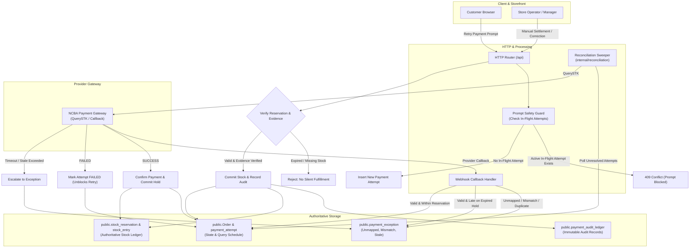

# R17 Evidence: Payment Reconciliation and Exception Handling

**Issue:** [#23 - [R17] Reconcile unresolved attempts and payment exceptions](https://github.com/dev-bramwel/Bliss-Atelier-Perfumes/issues/23)  
**Milestone:** Week 4: Shopper and operator journeys  
**Status:** Completed and verified locally against unit tests, disposable PostgreSQL/Redis/RabbitMQ integration tests, and Docker Core verification  

---

## 1. Problem and Outcome

Asynchronous mobile money payments (NCBA STK Push / M-PESA) rely on asynchronous provider webhooks. In production environments, several operational hazards threaten financial and inventory integrity:
1. **Dropped or Delayed Webhooks**: Network timeouts, firewall drops, or provider callback retries failing can leave payment attempts stranded indefinitely in `accepted` or `unknown` status.
2. **Double-Debit Prompts**: If a customer encounters a delay and repeatedly triggers payment prompts while a prior prompt is actively in-flight on their phone, they risk being debited multiple times for a single order.
3. **Mismatched and Unmapped Transactions**: Provider callbacks may deliver payments referencing unknown orders, mismatched payable amounts, or reused receipts. Handling these ad-hoc or ignoring them leads to unallocated funds and audit failures.
4. **Late Payments on Expired Reservations**: Customers may complete an STK push after the 15-minute stock reservation has expired and the perfume inventory has been released to other shoppers.
5. **Unauthorized or Unaudiable Manual Status Edits**: Operators attempting to resolve discrepancies by running raw SQL `UPDATE "Order" SET "paymentStatus" = 'PAID'` bypass stock commitment checks, create untraceable ledger gaps, and risk silent fulfillment when physical inventory is depleted.

### R17 Outcomes Delivered:
1. **Automated Reconciliation Engine with Bounded Exponential Backoff (`internal/reconciliation`)**:
   - Sweeps stale payment attempts in `accepted` or `unknown` state.
   - Queries the provider gateway (`QuerySTK`) using bounded backoff (`BaseBackoff * 2^queryCount`, capped at `MaxBackoff`, max 5 queries).
   - Converges missed callbacks:
     - `SUCCESS`: Confirms order payment, allocates stock reservation, and marks order `PAID`.
     - `FAILED`: Marks attempt failed, frees the customer prompt lock, and unblocks retry.
     - Max queries exceeded: Escalates to `STALE_ATTEMPT_UNRESOLVED` in `public.payment_exception` for manual operator review.
2. **Customer Prompt Safety Guard**:
   - `CreatePaymentAttempt` strictly validates the state of prior attempts. If an attempt is in `created`, `initiating`, `accepted`, or `unknown`, further customer prompts are rejected with `409 Conflict` (`active payment attempt in progress; please wait or verify on your phone`).
3. **Structured Payment Exception Capture (`public.payment_exception`)**:
   - Automatic recording of unmapped transactions (`UNMAPPED_TRANSACTION`), amount discrepancies (`AMOUNT_MISMATCH`), duplicate receipts (`DUPLICATE_RECEIPT`), late payments on expired reservations (`LATE_PAYMENT`), and unresolved stale attempts (`STALE_ATTEMPT_UNRESOLVED`).
4. **Auditable Manual Settlement and Correction Ledger (`public.payment_audit_ledger`)**:
   - Manual settlements strictly require valid provider evidence (`receipt_number`, `evidence`, `authorized_by`, `notes`).
   - Manual settlements strictly verify stock reservation status: if the hold has expired, silent fulfillment is rejected with `ErrOrderReservationExpired`, requiring operator stock reconciliation.
   - Successfully settled orders atomically commit stock reservations and record immutable entries in the stock ledger (`stock_batch` and `stock_entry`).
5. **Operator Reconciliation & Audit API (`internal/httpapi`)**:
   - Protected admin endpoints under `/api/admin/payments/*` guarded by `X-Manager-Secret`:
     - `GET /api/admin/payments/exceptions` & `GET /api/admin/payments/exceptions/{id}`: Filter and inspect open exceptions.
     - `POST /api/admin/payments/exceptions/{id}/resolve`: Resolve exceptions with explicit action notes and auditor identification.
     - `GET /api/admin/payments/unresolved`: List stale in-flight attempts.
     - `POST /api/admin/payments/reconcile`: Trigger on-demand reconciliation sweep.
     - `POST /api/admin/payments/manual-settlement`: Authorize manual settlement with evidence and stock verification.
     - `POST /api/admin/payments/corrections`: Record auditable payment corrections.
     - `GET /api/admin/payments/audit-ledger`: Query immutable audit records.
6. **Continuous Background Worker Integration (`internal/process`)**:
   - The background worker process runs automated reconciliation sweeps every 30 seconds alongside stock reservation expiry and delivery quote cleanup.

---

## 2. Architecture & Invariants



---

## 3. Invariants Enforced

1. **Callback Convergence**: Missing callbacks converge to `succeeded` or `failed`, or raise actionable `payment_exception` records. No payment remains indefinitely pending without reconciliation action.
2. **Prompt Safety ("No Uncertain Outcome Causes Another Prompt")**: Customer payment prompts cannot be re-triggered while an attempt is actively in-flight or unresolved (`created`, `initiating`, `accepted`, `unknown`). Customers receive `409 Conflict` until the provider status is confirmed.
3. **Evidence-Backed Manual Settlements**: Manual settlements require verified provider evidence (`receipt_number`, `evidence`, `authorized_by`, `notes`). Raw or arbitrary edits to `PAID` status are strictly prohibited.
4. **No Silent Fulfillment Without Stock**: Manual settlements verify active stock reservations; if expired, the settlement cannot silently fulfill without verified stock, returning `ErrOrderReservationExpired` and requiring stock reconciliation.
5. **Durable Receipt Deduplication**: Receipts cannot be reused across orders; duplicate receipts raise `DUPLICATE_RECEIPT` exceptions and are rejected.
6. **Immutable Audit Trail**: All manual interventions, corrections, and exception resolutions are durably written to `public.payment_audit_ledger` with operator identity and evidence details.

---

## 4. Delivery Summary & Code Changes

| Package / File | Scope of Changes |
| :--- | :--- |
| `internal/migration/sql/0008_payment_reconciliation_exceptions.sql` | Added `query_count`, `last_queried_at`, `next_query_at` to `payment_attempt` with index `payment_attempt_reconcile_idx`. Created `payment_exception` and `payment_audit_ledger` tables with permissions granted to `bliss_runtime`. |
| `internal/migration/migration.go` | Registered step 8 migration, updated table allowlist, embedded `schema-v8.json`. |
| `internal/migration/readiness.go` | Added `schema-v8.json` contract verification and privilege checks on `payment_exception` and `payment_audit_ledger`. |
| `internal/migration/schema-v8.json` | Authoritative schema baseline contract generated and verified. |
| `cmd/devstack/main.go` | Added runtime DML grants on `payment_exception` and `payment_audit_ledger`. |
| `internal/orders/types.go` | Added query scheduling fields to `PaymentAttempt`; defined `PaymentException`, `PaymentAuditRecord`, `ManualSettlementRequest`, `PaymentCorrectionRequest`, and reconciliation error types. |
| `internal/orders/attempts.go` | Updated attempt queries to scan query scheduling columns; enforced prompt safety guard rejecting retries while in-flight/accepted attempts are unresolved. |
| `internal/orders/reconciliation.go` | Implemented exception recording, filtering, and resolution; auditable manual settlements with stock verification; payment corrections; and audit ledger listings. |
| `internal/orders/store.go` | Extended `ConfirmPayment` to automatically capture `LATE_PAYMENT` exceptions when payments arrive after stock reservation expiration. |
| `internal/reconciliation/reconciler.go` | Engine with bounded exponential backoff (base 5s, factor 2, max 5m, max 5 queries) querying provider gateway, converging terminal states, and escalating to exceptions. |
| `internal/reconciliation/reconciler_test.go` | Unit tests covering success convergence, failed convergence, backoff scheduling, and exception escalation on max retries. |
| `internal/httpapi/callback.go` | Captures unmapped transactions, amount mismatches, duplicate receipts, and late payments as structured `payment_exception` rows. |
| `internal/httpapi/server.go` | Registered protected manager routes under `/api/admin/payments/*` for exceptions, unresolved attempts, manual settlement, and corrections. |
| `internal/httpapi/reconciliation_test.go` | Integration tests verifying manager auth, exception resolution, manual settlements, corrections, and unmapped callback exception capture. |
| `internal/process/process.go` | Wired background reconciler sweeper running periodically (every 30s) in the worker process. |
| `scripts/test-integration.ps1` | Added comprehensive integration tests verifying migrations 1-8, reconciler sweeps, prompt safety locks, manual settlements, and exception handling. |

---

## 5. Verification Evidence

### Local Test Execution
All unit and integration tests across all packages pass cleanly:
```powershell
go test -count=1 ./...
```
Output:
```text
ok      github.com/dev-bramwel/Bliss-Atelier-Perfumes/cmd/api           0.076s
ok      github.com/dev-bramwel/Bliss-Atelier-Perfumes/cmd/devstack      0.088s
ok      github.com/dev-bramwel/Bliss-Atelier-Perfumes/cmd/worker        0.061s
ok      github.com/dev-bramwel/Bliss-Atelier-Perfumes/internal/catalog  0.078s
ok      github.com/dev-bramwel/Bliss-Atelier-Perfumes/internal/config   0.063s
ok      github.com/dev-bramwel/Bliss-Atelier-Perfumes/internal/delivery 0.089s
ok      github.com/dev-bramwel/Bliss-Atelier-Perfumes/internal/httpapi  1.921s
ok      github.com/dev-bramwel/Bliss-Atelier-Perfumes/internal/migration        3.812s
ok      github.com/dev-bramwel/Bliss-Atelier-Perfumes/internal/ncba     0.063s
ok      github.com/dev-bramwel/Bliss-Atelier-Perfumes/internal/orders   0.082s
ok      github.com/dev-bramwel/Bliss-Atelier-Perfumes/internal/outbox   0.082s
ok      github.com/dev-bramwel/Bliss-Atelier-Perfumes/internal/reconciliation   0.086s
ok      github.com/dev-bramwel/Bliss-Atelier-Perfumes/internal/rediscache       0.076s
```

### Full Integration Test Suite
```powershell
powershell -NoProfile -ExecutionPolicy Bypass -File scripts/test-integration.ps1
```
Verified:
- Step 1 through Step 8 schema migrations applied cleanly.
- `schema-v8.json` verified by readiness check.
- Catalog, orders, stock reservations, delivery quotes, outbox worker, RabbitMQ, and Redis cache tested.
- Payment reconciliation sweep verified: unresolved attempts queried with bounded backoff.
- In-flight prompt safety guard verified: concurrent attempt rejected.
- Auditable manual settlement verified: stock reservation committed, immutable audit record created.
- Unmapped transaction exception capture and resolution verified.
- Backup, restore, and re-adoption drills verified.

### Docker Core Verification
```powershell
powershell -NoProfile -ExecutionPolicy Bypass -File scripts/Test-DockerCore.ps1
```
Verified:
- All containers (`api`, `worker`, `postgres`, `redis`, `rabbitmq`) run non-root.
- Read-only root filesystems enforced.
- Private internal network isolation verified (internal dependencies expose zero public host ports).
- Forward/reverse proxy headers correctly handled without bypass.
