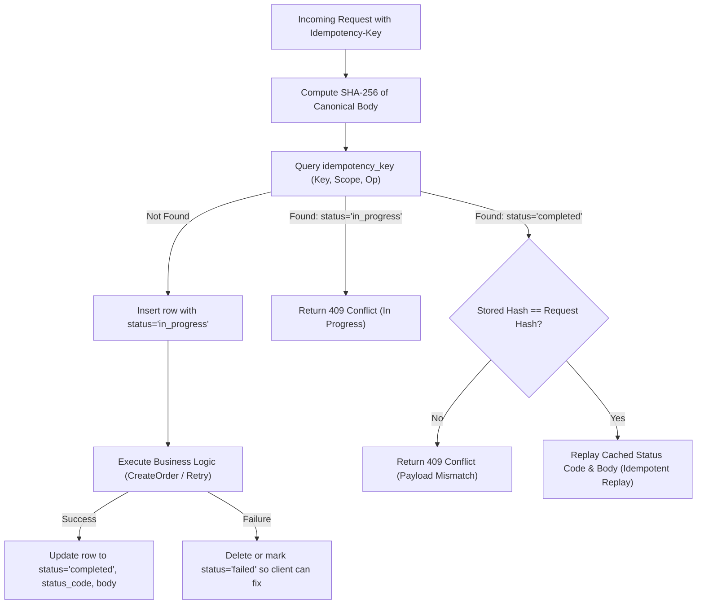

# Implementation Plan: [R13] Persist Payment Attempts and Durable Idempotency

**Issue:** [#19 - [R13] Persist payment attempts and durable idempotency](https://github.com/dev-bramwel/Bliss-Atelier-Perfumes/issues/19)  
**Milestone:** Week 3: Safe payments and background work  
**Priority:** P0 | **Area:** payments | **Dependencies:** #16 (R10), #17 (R11), #18 (R12) (All satisfied and merged)  

---

## 1. Problem Statement & Acceptance Criteria

When network drops, mobile retries, or double-clicks occur during checkout, the API must prevent duplicate orders, duplicate stock holds, and duplicate financial charges. Currently, order creation inserts directly without tracking idempotency keys, and order payments are represented only as a monolithic status on `Order`.

### Acceptance Criteria
- [ ] **Concurrent same-key requests**: Create exactly one logical order and attempt; concurrent requests safely coordinate without duplicate inventory deduction or multiple records.
- [ ] **Changed body rejection**: Submitting a different payload with an already-used idempotency key returns `HTTP 409 Conflict`.
- [ ] **Restart preserves replay**: Server restarts or stateless process redeployments preserve replay of completed responses from durable PostgreSQL storage.
- [ ] **Unresolved attempt safety**: Key expiry and concurrent retries never blindly reinitiate an unresolved or in-flight payment attempt. An explicit retry endpoint is introduced that checks prior attempt states before initiating a new charge.

---

## 2. Database Schema Design (`0006_payment_attempts_idempotency.sql`)

### A. Idempotency Key Storage (`public.idempotency_key`)
```sql
CREATE TABLE public.idempotency_key (
    key text NOT NULL,
    caller_scope text NOT NULL,
    operation text NOT NULL,
    request_hash text NOT NULL,
    status text NOT NULL CHECK (status IN ('in_progress', 'completed', 'failed')),
    status_code integer NOT NULL DEFAULT 0,
    response_headers jsonb NOT NULL DEFAULT '{}'::jsonb,
    response_body text NOT NULL DEFAULT '',
    resource_id text,
    created_at timestamptz NOT NULL DEFAULT now(),
    expires_at timestamptz NOT NULL,
    PRIMARY KEY (key, caller_scope, operation)
);

CREATE INDEX idempotency_key_expires_idx ON public.idempotency_key (expires_at);
```

### B. Payment Attempts Table (`public.payment_attempt`)
```sql
CREATE TABLE public.payment_attempt (
    id uuid PRIMARY KEY DEFAULT gen_random_uuid(),
    order_id text NOT NULL REFERENCES public."Order"(id) ON DELETE CASCADE,
    attempt_number integer NOT NULL CHECK (attempt_number > 0),
    amount_kes integer NOT NULL CHECK (amount_kes > 0),
    phone text NOT NULL,
    status text NOT NULL CHECK (status IN ('created', 'initiating', 'accepted', 'succeeded', 'failed', 'cancelled', 'unknown')),
    provider text NOT NULL DEFAULT 'mpesa_stk',
    provider_transaction_id text,
    provider_reference_id text,
    error_message text,
    created_at timestamptz NOT NULL DEFAULT now(),
    updated_at timestamptz NOT NULL DEFAULT now(),
    UNIQUE (order_id, attempt_number)
);

CREATE INDEX payment_attempt_order_idx ON public.payment_attempt (order_id);
CREATE INDEX payment_attempt_status_idx ON public.payment_attempt (status);
```

---

## 3. Idempotency Lifecycle & Execution Flow



---

## 4. Payment Attempt Management & Explicit Retry API

### Endpoints:
1. `POST /api/orders` (and `/orders`):
   - Uses `Idempotency-Key` header (if absent, generates a scoped client hash).
   - Creates the order, reservation, guest token, and `payment_attempt` #1 (`created`).
   - Caches 201 response in `idempotency_key`.
2. `POST /api/orders/{id}/retry-payment`:
   - Scoped authorization using `X-Guest-Token` or manager credentials via `AuthorizeOrderAccess`.
   - Requires `Idempotency-Key`.
   - **Pre-flight Checks**:
     - Order cannot be `PAID`.
     - Stock reservation must be active (unexpired).
     - Queries latest `payment_attempt` for the order:
       - If latest attempt status is `initiating` or `accepted` (and within provider resolution window, e.g. 2 minutes), reject retry with `HTTP 409 Conflict`: *"An active payment prompt is in progress; wait for confirmation or timeout."*
       - If latest attempt is `failed`, `unknown`, or `expired`: insert new `payment_attempt` with `attempt_number = last + 1`.
3. `GET /api/orders/{id}/payment-status`:
   - Enhanced to return the latest payment attempt ID and attempt status alongside order payment status.

---

## 5. Implementation Roadmap & Steps

| Phase | Tasks | Key Files |
| :--- | :--- | :--- |
| **Phase 1: Database Migration & Schema Contract** | Write `0006_payment_attempts_idempotency.sql`. Update `migration.go`, `readiness.go`, and test fixtures to generate `schema-v6.json`. | [`internal/migration/sql/0006_payment_attempts_idempotency.sql`](file:///C:/Users/mutug/Documents/Bliss-Atelier-Perfumes/internal/migration/sql), [`internal/migration/migration.go`](file:///C:/Users/mutug/Documents/Bliss-Atelier-Perfumes/internal/migration/migration.go) |
| **Phase 2: Orders Store & Types** | Define `PaymentAttempt` and `IdempotencyRecord` structs. Implement `ExecuteIdempotent(ctx, key, scope, op, body, fn)`, `CreatePaymentAttempt`, and `GetLatestPaymentAttempt`. Update `CreateOrder`. | [`internal/orders/types.go`](file:///C:/Users/mutug/Documents/Bliss-Atelier-Perfumes/internal/orders/types.go), [`internal/orders/store.go`](file:///C:/Users/mutug/Documents/Bliss-Atelier-Perfumes/internal/orders/store.go), [`internal/orders/idempotency.go`](file:///C:/Users/mutug/Documents/Bliss-Atelier-Perfumes/internal/orders) |
| **Phase 3: HTTP API Integration** | Wire `Idempotency-Key` processing into `handleCreateOrder`. Add `POST /api/orders/{id}/retry-payment`. Redact idempotency tokens if needed. | [`internal/httpapi/server.go`](file:///C:/Users/mutug/Documents/Bliss-Atelier-Perfumes/internal/httpapi/server.go) |
| **Phase 4: Comprehensive Test Suite** | Add unit tests covering: replay of identical requests, 409 on changed payload, 409 on in-progress concurrent request, restart simulation, unresolved attempt blocking, and explicit retry lifecycle. | [`internal/orders/store_test.go`](file:///C:/Users/mutug/Documents/Bliss-Atelier-Perfumes/internal/orders/store_test.go), [`internal/httpapi/server_test.go`](file:///C:/Users/mutug/Documents/Bliss-Atelier-Perfumes/internal/httpapi/server_test.go) |
| **Phase 5: Evidence & Documentation** | Create `docs/evidence/r13-payment-attempts-idempotency.md`, update `docs/architecture.md` / `docs/ncba-payments.md`. Run integration drills. | [`docs/evidence/r13-payment-attempts-idempotency.md`](file:///C:/Users/mutug/Documents/Bliss-Atelier-Perfumes/docs/evidence) |

---

## 6. Verification Plan
- Unit tests: `go test -count=1 ./...`
- Schema and legacy fingerprint drills: `powershell -ExecutionPolicy Bypass -File scripts/test-integration.ps1`
- Docker core validation: `powershell -ExecutionPolicy Bypass -File scripts/Test-DockerCore.ps1`
- Code formatting & linters: `gofmt -w cmd internal web`
