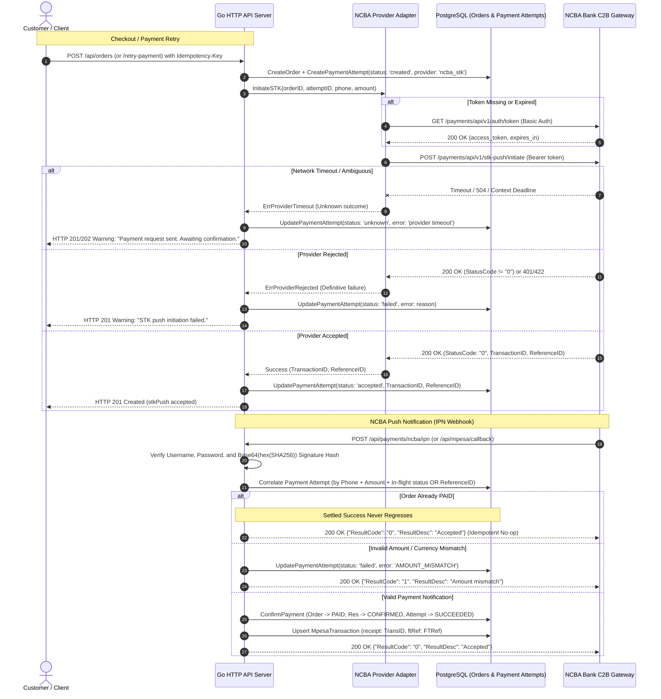

# Implementation Plan: [R14] Bounded Provider Adapter and Guarded Callbacks (NCBA Bank Integration)

**Issue:** [#20 - [R14] Implement bounded provider adapter and guarded callbacks](https://github.com/dev-bramwel/Bliss-Atelier-Perfumes/issues/20)  
**Milestone:** Week 3: Safe payments and background work  
**Priority:** P0 | **Area:** payments | **Dependencies:** [#8 (R02)](https://github.com/dev-bramwel/Bliss-Atelier-Perfumes/issues/8), [#19 (R13)](https://github.com/dev-bramwel/Bliss-Atelier-Perfumes/issues/19) (Both satisfied and merged)  
**Primary Provider:** **NCBA Bank PLC** (Paybill `880100` + NCBA Till Short Code/Alias)  
**Branch:** `feat/20-provider-adapter-callbacks`

---

## 1. Problem Statement & Background

The business uses **NCBA Bank** for merchant mobile money collections. Under `docs/NCBA integration`, the bank supplies three official technical specifications:
1. **`NCBA TILL STK PUSH & DYNAMIC QR CODE API_2024.pdf`**:
   - Token endpoint: `GET /payments/api/v1/auth/token` via HTTP Basic auth (`username:password`). Returns JWT `access_token` with `expires_in` (typically 18,000s / 5 hours).
   - STK Push Initiate: `POST /payments/api/v1/stk-push/initiate` via Bearer token.
     - Payload: `TelephoneNo`, `Amount`, `PayBillNo` (`880100`), `AccountNo` (Merchant NCBA Till alias), `Network` (`Safaricom`), `TransactionType` (`CustomerPayBillOnline`).
     - Success response: `TransactionID`, `StatusCode: "0"`, `StatusDescription`, `ReferenceID`.
   - STK Query: `POST /payments/api/v1/stk-push/query` via Bearer token and `TransactionID`.
2. **`NCBA Paybill-Level Push Notifications Service Guide.pdf`**:
   - IPN Webhook format: HTTP POST with JSON (or XML; JSON selected).
   - Security: `Username`, `Password`, and `Hash`.
   - Hash formula:
     ```
     hashString = secretKey + TransType + TransID + TransTime + TransAmount + CreditAccount + BillRefNumber + Mobile + Name + "1"
     sha256hex = LowercaseHex(SHA256(hashString))
     Hash = Base64(sha256hex.getBytes())
     ```
   - Parameters for NCBA Till under Paybill 880100: `TransType` ("Pay Bill"), `TransID` (M-Pesa receipt), `FTRef` (core banking reference), `TransTime`, `TransAmount`, `BusinessShortCode` ("880100"), `BillRefNumber` (Till alias), `Narrative`, `Mobile`, `name`.
   - Acknowledgment: `{"ResultCode": "0", "ResultDesc": "Test API Response"}` on success; `{"ResultCode": "1", ...}` on failure.
3. **`C2B QUERY API SERVICE GUIDE NOV 2024.pdf`**:
   - Token endpoint: `GET /api/auth/generate-token` via HTTP Basic auth.
   - Transaction Query: `POST /api/payments/query` with `SHORTCODE`, `TYPE: "CORPORATE"`, `MPESA_REFERENCE: "..."`. Returns matching transaction details array.

---

## 2. Architecture & Data Flow



---

## 3. Core Components Design

### A. Typed Provider Port (`internal/provider/provider.go`)

```go
type PaymentProvider interface {
    InitiateSTK(ctx context.Context, req STKInitiateRequest) (*STKInitiateResponse, error)
    QuerySTK(ctx context.Context, req STKQueryRequest) (*STKQueryResponse, error)
    QueryReceipt(ctx context.Context, req ReceiptQueryRequest) (*ReceiptQueryResponse, error)
}

type STKInitiateRequest struct {
    OrderID   string
    AttemptID string
    Phone     string
    AmountKes int
}

type STKInitiateResponse struct {
    TransactionID       string // NCBA STK TransactionID
    ReferenceID         string // NCBA ReferenceID
    StatusCode          string // "0" = accepted
    StatusDescription   string
}

type STKQueryRequest struct {
    TransactionID string
}

type STKQueryResponse struct {
    Status      string // "SUCCESS" or "FAILED"
    Description string
}

type ReceiptQueryRequest struct {
    Shortcode      string
    MpesaReference string
}

type ReceiptQueryResponse struct {
    Status       int
    Transactions []ReceiptTransaction
}

type ReceiptTransaction struct {
    TransID     string
    TransAmount float64
    Mobile      string
    TransTime   string
    BillRef     string
}
```

#### Provider Errors:
- `ErrProviderTimeout`: Request timed out; outcome is **UNKNOWN**.
- `ErrProviderRejected`: Rejection or invalid credentials; outcome is **FAILED**.
- `ErrProviderMalformed`: Malformed JSON from provider.
- `ErrProviderOversized`: Provider response exceeds 64KB limit.

---

### B. NCBA Bank Adapter (`internal/provider/ncba.go`)
- **Configuration (`NCBAConfig`)**:
  - `BaseURL`: Default `https://c2bapis.ncbagroup.com` (configurable for tests / devstack).
  - `Username` & `Password`: Basic auth credentials for `/payments/api/v1/auth/token`.
  - `PayBillNo`: `880100`.
  - `AccountNo`: Merchant's NCBA Till short code / alias (kept in config).
  - `IPNUsername`, `IPNPassword`, `IPNSecretKey`: Credentials used to authenticate and verify the IPN notification hash.
- **Race-Safe Token Reuse**:
  - Uses `sync.RWMutex`.
  - Caches `access_token` and `expiresAt`. If `time.Now().Add(5*time.Minute).After(expiresAt)`, performs thread-safe refresh before sending requests.
- **Transport Security**:
  - Leverages bounded HTTP client (`Client.DoJSON`) with strict timeouts, 64KB response ceiling, and connection pooling.
  - Formats phone numbers to `2547XXXXXXXX`.

---

### C. Fake Adapter (`internal/provider/fake.go`)
- Supports testing all edge cases locally and in CI:
  - `ModeAccept`: Returns immediate acceptance with mock `NCBA_TX_...` and `NCBA_REF_...`.
  - `ModeReject`: Returns `StatusCode: "1"` with failure description.
  - `ModeTimeout`: Simulates context deadline cancellation.
  - `ModeMalformed`: Simulates unparseable provider JSON.

---

### D. Guarded NCBA IPN & Callback Handlers (`internal/httpapi/`)
1. **Endpoint**: `POST /api/payments/ncba/ipn` (and compatibility alias `POST /api/mpesa/callback`).
2. **Authentication & Hash Verification (`VerifyNCBAIPNHash`)**:
   - Compares incoming `Username` and `Password` against configured IPN credentials in constant time.
   - Computes:
     ```go
     hashString := secretKey + req.TransType + req.TransID + req.TransTime + req.TransAmount + req.BusinessShortCode + req.BillRefNumber + req.Mobile + req.Name + "1"
     sha := sha256.Sum256([]byte(hashString))
     hexDigest := hex.EncodeToString(sha[:]) // lowercase hex
     expectedHash := base64.StdEncoding.EncodeToString([]byte(hexDigest))
     ```
   - Constant-time verification prevents timing attacks.
   - If invalid -> return HTTP 401 / `ResultCode: "1"`.
3. **Capability URL Guard**:
   - For callbacks that supply URL parameters (`?orderId=...&signature=...`):
   - HMAC-SHA256 signature is verified.
   - **Critical Rule**: Callback URL capability is **never treated as a provider body signature**. Payload amounts and fields are independently authenticated and validated against order expectations.
4. **Correlation & Transactional Transition**:
   - Finds order and latest active attempt by:
     - Matching `BillRefNumber` or capability `orderId`.
     - Matching `Mobile` + `TransAmount` on recently active in-flight attempts.
   - **Callback-Before-Mapping**:
     - If attempt is found before initiation returned `provider_transaction_id`: links `TransID` and confirms immediately.
     - If completely unmapped: returns HTTP 503 (`ResultCode: "1"`, "Transaction is not available yet") so NCBA queues redelivery.
   - **Settled Success Never Regresses**:
     - If order `paymentStatus == 'PAID'`:
       - Duplicate success: Idempotently acknowledges with `ResultCode: "0"` without modifying inventory or ledger.
       - Late failure: Does NOT downgrade order `paymentStatus`. Acknowledges with `ResultCode: "0"`.
   - **Amount & Currency Verification**:
     - Parses `TransAmount` (handles integer or decimal formats: `2500`, `2500.0`, `2500.00`).
     - Verifies `TransAmount == attempt.AmountKes`.
     - On mismatch: marks attempt `failed` with `failure_reason = "AMOUNT_MISMATCH"`; does NOT mark order `PAID`.
   - **Receipt Deduplication**:
     - Ensures `TransID` (M-Pesa receipt) has not been previously recorded for another order.
   - **State Transition Execution**:
     - Calls `orderStore.ConfirmPayment(...)` which atomically marks order `PAID`, reservation `CONFIRMED`, creates immutable stock ledger batch, and marks attempt `SUCCEEDED`.
     - Upserts `MpesaTransaction` with `TransID` and `FTRef`.

---

### E. Integration with Order Checkout & Retries (`internal/httpapi/server.go`)
- On `POST /api/orders` (and `POST /api/orders/{id}/retry-payment`) with `paymentMethod == "mpesa"`:
  - Dispatches `provider.InitiateSTK(...)`.
  - On acceptance: attempt marked `accepted`, response returns `stkPush` details.
  - On timeout: attempt marked `unknown` (enforcing the 2-minute unresolved window), response returns safe warning.
  - On rejection: attempt marked `failed`, response returns error.

---

## 4. Verification & Testing Plan

1. **Adapter Unit Tests (`internal/provider/ncba_test.go`)**:
   - `TestNCBA_InitiateSTK_Success`: Validates request payload schema matches NCBA guide (`TelephoneNo`, `Amount`, `PayBillNo`, `AccountNo`, `Network`, `TransactionType`).
   - `TestNCBA_TokenReuse_ThreadSafe`: 50 concurrent calls sharing cached JWT token without race conditions or multiple logins.
   - `TestNCBA_IPN_HashVerification`: Known-answer test verifying Base64(hex(SHA256)) hash generation against NCBA Java reference specification.
   - `TestNCBA_InitiateSTK_Timeout`: Verifies `ErrProviderTimeout` returned on network deadline.
   - `TestNCBA_InitiateSTK_Rejected`: Verifies `ErrProviderRejected` on non-zero `StatusCode`.
2. **Guarded IPN & Callback HTTP Tests (`internal/httpapi/callback_test.go`)**:
   - `TestNCBA_IPN_ValidPayment`: Full successful transition from pending order to `PAID`, `payment_attempt` to `SUCCEEDED`, receipt and `FTRef` recorded.
   - `TestNCBA_IPN_InvalidCredentials`: Bad username/password/hash returns 401.
   - `TestNCBA_IPN_SettledSuccessNeverRegresses`:
     - Duplicate valid notification returns 200 without duplicate ledger entries.
     - Out-of-order or late failure notification does not downgrade `PAID` status.
   - `TestNCBA_IPN_AmountMismatch`: TransAmount != expected total rejects payment, leaves order `PENDING`.
   - `TestNCBA_IPN_ReceiptDeduplication`: Reusing an existing `TransID` for a second order is rejected.
   - `TestNCBA_IPN_CallbackBeforeMapping`: In-flight attempt correlation and 503 response on unmapped transactions.
   - `TestDaraja_LegacyCallbackCompatibility`: Verifies `/api/mpesa/callback` with Daraja payload and capability URL signature works seamlessly.
3. **Integration Drills**:
   - Full test run: `go test -count=1 ./...`
   - Integration script: `powershell -ExecutionPolicy Bypass -File scripts/test-integration.ps1`

---

## 5. Definition of Done & Delivery Evidence
- Create `docs/evidence/r14-bounded-provider-callbacks.md`.
- Update `docs/evidence/README.md`.
- Schema changes marked not applicable with reason (`schema-v6` contains all required tables and fields).
- All CI checks green.
